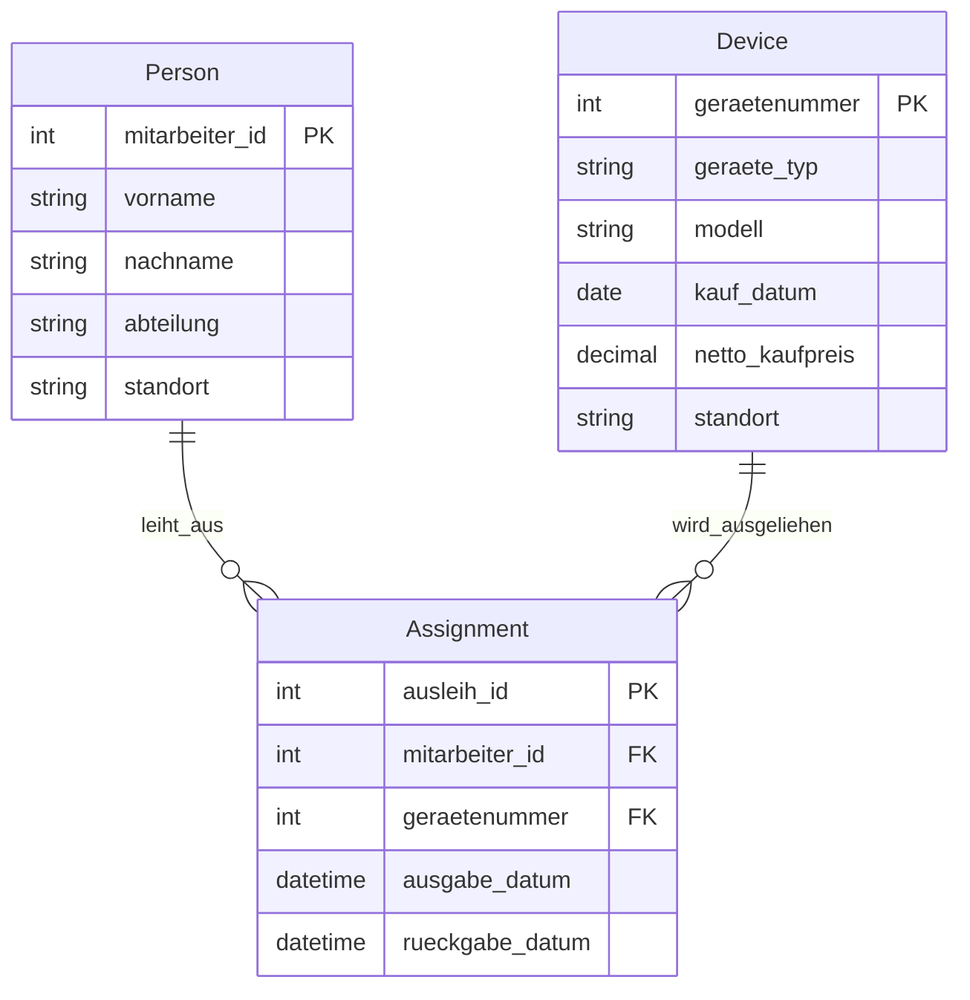

# Aufgabe B: ER-Modell für die Geräteausleihe
## Mermaid-ERD

## Fachregeln

- **R1 - Höchstens eine aktive Ausleihe für ein Gerät** 
- **R2 - Verfügbar oder ausgeliehen:** Ein Gerät ist ausgeliehen wenn `rueckgabe_datum IS NULL` gilt. 
- **R3 - Gültige Zeitfolge:** Ein eingetragener Rückgabezeitpunkt darf nicht vor dem Ausgabezeitpunkt liegen und für das selbe Gerät nicht im selben Zeitrahmen überschneiden.
- **R4 - Stabile Kennungen** IDs werden nicht neu vergeben 
